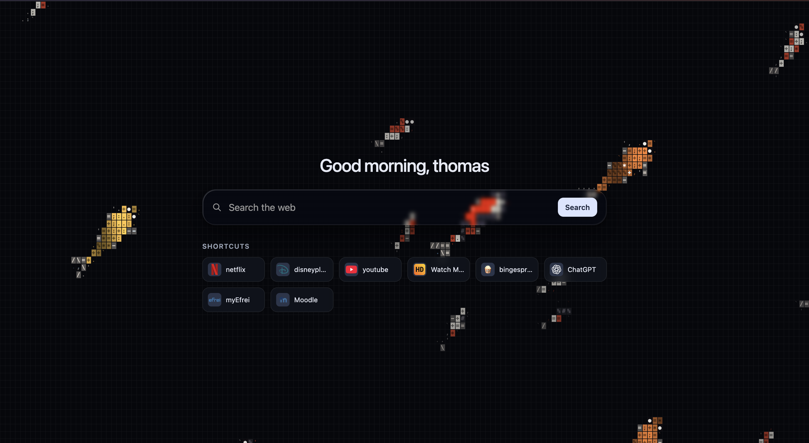

# ASCII Animals for Firefox

Animated ASCII animals on every new tab, with a search box that uses your default Firefox search engine.



## Original project

This extension adapts [DesignerStephen1/ascii-animals](https://github.com/DesignerStephen1/ascii-animals), by Stephen Zhang, with its original animal engine and renderer. The upstream project is MIT licensed; the original copyright and license notice are retained in [LICENSE](LICENSE).

## Load and build

The checked-in root files are ready to load. In Firefox, open `about:debugging#/runtime/this-firefox`, choose **Load Temporary Add-on**, and select `manifest.json` at the repository root. Open a new tab to see the extension. Temporary add-ons are removed when Firefox restarts.

After editing the source, rebuild with Node.js and npm:

```sh
npm ci
npm run typecheck
npm test
npm run build
```

After rebuilding, click **Reload** for ASCII Animals on the debugging page.

To personalize it, click the **ASCII Animals toolbar button → Open settings**. The settings page is also available through **Add-ons and themes → Extensions → ASCII Animals → Preferences**. Choose one animal or **Random animal**, then select the animals in the random pool. Random mode picks one animal for each new tab. Set an optional greeting name and adjust movement, appearance, and search glass. Settings are saved in `browser.storage.local` and update open animal tabs. The new-tab page has no personalization controls.

Firefox's pinned New Tab shortcuts are displayed below search using the `topSites` API. The extension reads Firefox's existing shortcut list; it does not change the pins.

The root directory is the loadable extension. It requests `storage` for preferences, `search` to use Firefox's default search engine in the current tab, and `topSites` to show Firefox's New Tab shortcuts. It makes no network requests of its own.

## Source

`src/` contains the animal engine and renderer. `extension/` contains the Firefox new-tab, popup, settings code, and editable HTML templates. `npm run build` compiles them into the root `index.html`, `popup.html`, `options.html`, and `assets/`. The root `manifest.json` points to those compiled pages.

Movement, appearance, and search glass values are stored per animal, including in Random mode. Switching animals restores each animal's values. Settings from the earlier version, where glass was shared, are carried over to every animal on first load.

## Firefox Add-ons source review

The add-on ZIP contains the built files: `manifest.json`, `icon.svg`, `index.html`, `options.html`, `popup.html`, `assets/`, and `LICENSE`. The separate source ZIP contains this README, `docs/images/new-tab-preview.png`, `manifest.json`, `icon.svg`, `page.css`, `src/`, `extension/`, `scripts/`, `tests/`, `package.json`, `package-lock.json`, `tsconfig.json`, `vite.config.ts`, and `LICENSE`.

The build uses the open source TypeScript and Vite packages from npm, with versions fixed by `package-lock.json`. No private repository, credentials, environment variables, or extra build tools are needed. Run `npm ci`, then `npm run typecheck`, `npm test`, and `npm run build`. The build writes the extension pages and bundled assets at the repository root. To test, load the root `manifest.json` in Firefox 142 or later, open a new tab, and click the toolbar button to open settings.

The release build was tested on macOS 15.7.7 with Node.js 22.22.2 and npm 10.9.7. The build uses standard Node.js and npm commands and should also run in Mozilla's default Linux review environment.
